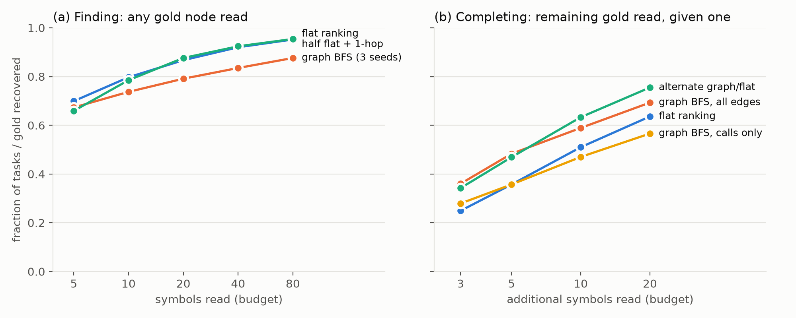

# Find Flat, Complete on the Graph

### When do code graphs help small coding agents localize bugs? An open 498-task benchmark in the competition's graph schema, and a Gemma 4 study

## Abstract

The Gemma 4 Developer Agent harness gives agents code-graph tools (`get_code_neighbors`, `get_code_subgraph`, `search_similar_code`). We ask: **for bug localization, when should a small on-device agent use the graph instead of plain retrieval?** We release **GraphLoc-498**, a reproducible benchmark of 498 real bug fixes from 8 Python repositories (the 4 competition repositories plus 4 held out). Each task pairs a pre-fix GitHub issue with function-level gold labels and a code graph in the competition's NetworkX schema. Comparing 25 strategies at equal *read budgets*, we find a clean division of labour:

1. **Graphs are poor finders.** Graph expansion from top hits trails simply reading further down a flat ranking at every budget (0.84 vs 0.92 hit rate at 40 symbols).
2. **Graphs are good completers.** Once one edit site of a multi-location fix is known, graph search recovers **45% more of the remaining sites** than the flat ranking at a 3-symbol budget. Structural edges matter; call edges alone do not help.
3. **256-d embeddings suffice if projected.** Truncating a 1536-d embedder to 256 dimensions loses 8 points of Acc@5. PCA to 256 dimensions loses nothing.
4. **Gemma-4-E4B (4-bit, consumer GPU) is the strongest single step.** As a listwise reranker it lifts top-1 accuracy from 42.0% to 53.4% (+11.4 points, 95% CI [6.8, 16.3]), and its pick is a reliable anchor for graph completion. A cautionary result: naive cross-repository QLoRA fine-tuning on 219 tasks *hurts* (−7 to −11 points top-1 across three designs), because the adapter learns the label-position distribution of its training lists.

We distil these into a policy, *Find Flat, Complete on the Graph* (FFCG).

## 1. Introduction

Small open models struggle with repository-level software engineering less because they cannot write a patch than because they **cannot find where to write it**. Localization is a recognised bottleneck for coding agents (Xia et al., 2024; Chen et al., 2025), and the competition responds by shipping each repository as a call/dependency graph with node embeddings. But graph-guided localization is usually evaluated end-to-end with frontier models, hiding *which* part of the graph helps, *when*, and *at what context cost*, the scarcest resource for a small model.

We isolate localization and measure it under a **read budget**: the number of symbols whose source the agent must place in context. Contributions:

- **GraphLoc-498 (resource):** 498 issue-linked fixes with function-level gold labels and graphs in the competition schema. 219 tasks come from the competition repositories (more than the 129 public training tasks) and 279 from held-out ones, all regenerated by an open pipeline from `git` and the GitHub API.
- **An equal-budget methodology** separating *finding* the first edit site from *completing* a multi-site fix.
- **Findings** on retrievers, embedding dimensionality, graph propagation, and Gemma 4 reranking, plus a diagnosed negative result for LoRA fine-tuning, with paired bootstrap CIs.
- **A policy (FFCG) and harness guidance.**

## 2. GraphLoc-498

**Mining.** We replay first-parent history and keep commits whose diff touches 1–3 non-test `.py` files (2–120 changed lines) *and* a test file, the same "code + test" filter the competition uses. We follow each pull request's `closingIssuesReferences` (or `fixes #N`) and keep the task only if the linked **issue predates the PR**. The issue text becomes the problem statement, which avoids PR descriptions that leak the fix. Fields follow the competition's `tasks.jsonl`.

**Graphs.** For each `base_commit` we parse all non-test sources with Python's `ast` module. Nodes are modules, classes and functions/methods with dotted ids (`requests.models.PreparedRequest.prepare_body`) and source `text`. Edges are `contains`, `calls`, `imports` and `inherits`. Calls are resolved through local scopes, imports, package re-exports, `self`/`cls`/`super()` dispatch over the class hierarchy, and a unique-name fallback. Graphs are NetworkX node-link JSON in the competition schema, so they drop into its graph tools.

**Gold labels.** Each edited or inserted line of the gold patch maps to the innermost enclosing function or class at `base_commit`. We drop 19 of 517 tasks that only touch module-level code.

<<TABLE1>>

*Table 1. GraphLoc-498 by repository (means; Δlines is the median).*

**48% of tasks edit more than one symbol**, which motivates the completion analysis. FastAPI yields few tasks: most of its bug reports live in GitHub Discussions, not Issues.

## 3. Methods

**Candidates** are all function and class nodes of the snapshot (about 560 per task). Reading a node means placing its source in context.

**Flat retrievers.** *BM25* over identifier-split ids (weighted ×3) plus source. *Dense*: Qodo-Embed-1-1.5B (code, 1536-d) or bge-base-en-v1.5 (general, 768-d), cosine similarity between the issue and `id + source`. *Mention*: exact identifier matches, which mimics `grep`. *Fusion* (`fuse2`): reciprocal-rank fusion (Cormack et al., 2009) of dense and BM25, weighted 2:1.

**256-d embeddings.** The competition ships 256-d node embeddings, so we compare the full embedder, truncation to the first 256 dimensions, and a per-snapshot PCA to 256 dimensions fitted on node embeddings only.

**Graph strategies.** (i) *Personalized PageRank* (PPR; Haveliwala, 2002; cf. HippoRAG, Gutiérrez et al., 2024) seeded with the top-10 flat results and blended with the flat rank. (ii) *1-hop expansion* of the top-3 seeds, the `get_code_neighbors` analogue. (iii) *Breadth-first search* (BFS) from seeds under a budget, with neighbours ordered by flat rank. Each runs over `calls`, structural (`contains`+`inherits`), or `all` edges.

**Equal-budget protocols.** *Finding*: is any gold node among the B nodes read? *Completing*: on multi-site tasks, given the first gold node in the flat ranking (one site found and confirmed), what fraction of the *remaining* gold nodes is recovered within B more reads?

**Gemma 4 reranking.** Gemma-4-E4B-it (a competition base model), with 4-bit NF4 weights on one 16 GB consumer GPU, sees the issue and the top-20 `fuse2` candidates (id plus the first six source lines). It outputs up to five indices with greedy decoding and no reasoning tokens. The **graph** condition adds each candidate's callers and callees. The pool is identical across conditions. **Statistics:** paired bootstrap over tasks (5,000 resamples, 95% CI).

## 4. Results

### 4.1 Flat retrieval is a strong baseline

<<TABLE2>>

The code embedder beats BM25 by 10.5 points Acc@5, and fusion adds 2.8. Every method is markedly weaker on the competition repositories than on the held-out ones (Acc@5 0.571 vs 0.799), likely because `rich` and `httpx` have larger graphs and longer issues.

### 4.2 256 dimensions are enough, if you project

| Qodo-Embed-1-1.5B | Acc@1 | Acc@5 | Acc@10 | MRR |
|---|---|---|---|---|
| full 1536-d | 0.363 | 0.671 | 0.743 | 0.496 |
| first 256 dims (truncate) | 0.313 | 0.592 | 0.695 | 0.440 |
| PCA → 256-d | **0.376** | 0.669 | **0.765** | **0.516** |

bge-base shows the same pattern (Acc@5: truncate 0.584, PCA 0.586, full 0.616). Neither model was trained with Matryoshka objectives (Kusupati et al., 2022), so truncation discards signal while PCA keeps the useful subspace. **For competitors:** how the 256 dimensions are obtained matters more than their number.

### 4.3 Graphs are poor finders

*Figure 1. (a) Probability that any gold node is read, at equal budget. (b) Fraction of the remaining gold recovered once one gold node is known (235 multi-site tasks).*

Graph re-ranking barely moves the needle: PPR over calls takes Acc@5 from 0.671 to 0.679. 1-hop expansion *hurts* (Acc@5 0.616–0.629), because neighbours displace good flat candidates. At equal budget (Fig. 1a), BFS from the top-3 seeds trails the flat ranking everywhere (0.673 vs 0.699 at 5 reads; 0.835 vs 0.920 at 40).

Hop distances explain why. The top-1 result is wrong in 58% of tasks, and gold is then often far away: **36% of tasks have no gold within 3 call edges** of the top-1 hit (10% with all edge types). A wrong seed sends exploration into the wrong neighbourhood; the flat ranking keeps sampling independent hypotheses.

### 4.4 Graphs are good completers

The picture reverses once one site is known (Fig. 1b). Co-edited symbols cluster: in **69% of multi-site fixes** at least two gold nodes are directly connected (49% via calls alone). BFS over *all* edges from the known site recovers 0.360 of the remaining gold within 3 reads, versus 0.249 for the flat ranking (+45% relative). Alternating graph and flat picks is best at larger budgets (0.633 vs 0.510 at 10; 0.755 vs 0.636 at 20). **Edge type matters:** calls alone tie flat at 5 reads and fall behind from 10 onward (0.470 vs 0.510). Sibling methods, overrides and subclass hooks connect through `contains`/`inherits`, so `get_code_neighbors(node, edge_type="calls")` leaves most of the graph's value unused.

### 4.5 End-to-end policy: Find Flat, Complete on the Graph

Without knowing which hit is correct, FFCG reads the top-s flat results, then alternates graph BFS from those anchors (all edges) with further flat results. With s = 3 it improves recall@10 by **+2.6 points** [0.8, 4.4] and all-gold@20 by +2.4 [0.2, 4.6], with no change in Acc@5. The gain is modest *because the anchor is unverified*. §4.4 shows the headroom (up to +12 points) that a reliable confirmation signal would unlock.

### 4.6 Gemma 4 as reranker and gate

| Gemma-4-E4B-it (4-bit), top-20 `fuse2` pool | Acc@1 | Acc@5 | Δ Acc@1 vs retrieval [95% CI] | Prompt tokens |
|---|---|---|---|---|
| Retrieval only (`fuse2`) | 0.420 | 0.699 | – | – |
| Gemma rerank, plain candidates | 0.516 | 0.749 | +9.6 [5.2, 14.1] | 2,013 |
| Gemma rerank, + call-graph context | **0.534** | **0.757** | +11.4 [6.8, 16.3] | 2,461 |

*Table 3. Listwise reranking with Gemma 4. Gold is in the pool for 86.7% of tasks, the ceiling for Acc@k ≤ 20.*

**Reranking.** Without reasoning tokens, Gemma ranks gold first in 59.5% of tasks where it is in the pool. The gain holds on both splits: competition repositories 0.329 → 0.425, held-out 0.491 → 0.588 (plain prompt).

**Graph context in the prompt** adds 22% more tokens for a non-significant +1.8 points [−1.0, 4.6]. Consistent with §4.3, knowing what a candidate connects to does little to decide whether it is the bug.

**Gemma as the gate.** Using Gemma's top pick as the single FFCG anchor improves all-gold@20 by **+4.6** [2.2, 7.0] over Gemma's own ranking. That is more than twice the gain from an unverified retrieval anchor. The full stack (retrieval → Gemma rerank → graph completion) beats retrieval alone by +11.4 Acc@1, +6.8 Acc@5 and +4.0 all-gold@20, all significant.

### 4.7 LoRA fine-tuning: a diagnosed negative result

We QLoRA-tuned E4B (r = 16 on attention and MLP projections, 35M parameters, answer-token loss) on the 219 competition-repo tasks and evaluated it on the 279 held-out-repo tasks with the identical prompt. When retrieval missed a gold symbol, we inserted it into the training list; each task appeared in two or three candidate orders.

| Held-out repos | Acc@1 (LoRA vs zero-shot) | Acc@5 | Δ Acc@1 [95% CI] | First pick at index ≥ 10 |
|---|---|---|---|---|
| v1: missed gold inserted at list tail | 0.495 vs 0.588 | 0.814 vs 0.810 | −9.3 [−15.1, −3.6] | 37% vs 6% |
| v2: random insertion, mostly shuffled lists | 0.493 vs 0.604 (n = 227) | 0.811 vs 0.815 | −11.0 [−17.2, −4.8] | 40% vs 5% |
| v3: one copy in retrieval order, one shuffled (LR 5e-5) | 0.520 vs 0.588 | 0.803 vs 0.810 | −6.8 [−11.5, −2.2] | 34% vs 6% |

All adapters cut Acc@1 and leave Acc@5 unchanged; the last column shows why. v1 learned a shortcut: inserted gold always sat at the end of the list. v2 removed the shortcut, but shuffling taught a *uniform* position prior, discarding the retrieval-order prior that zero-shot Gemma exploits (on held-out repos its first pick is the retrieval top-1 43% of the time, v3's only 32%). v3 restored retrieval order in half the copies and shrank the loss, but injected gold at random slots still pulls picks deep into the list. **Lesson for competitors:** with a few hundred tasks, listwise SFT mostly learns the label-position distribution of its training lists. Train only on test-time-like lists (retrieval order, no injected gold), or give rank as an explicit feature.

## 5. Guidance for agents in the competition harness

1. **Find flat.** Query `search_similar_code` with the issue, combine it with `grep` on identifiers, and read the top 5–10 symbols. Don't spend early turns on `get_code_neighbors`.
2. **Rerank cheaply.** A 4-bit E4B listwise rerank of 20 candidates costs about 2k tokens and 5 s, and it was the most effective single step we measured.
3. **Fine-tune with care.** If you train a reranker LoRA, train on lists exactly as retrieval returns them. Shuffled or gold-injected lists teach position priors that cost 7–11 points top-1 (§4.7).
4. **Confirm, then complete on the graph.** Once a site is confirmed (a failing reproduction test, or the model's pick after reading it), call `get_code_neighbors(node)` **without** an `edge_type` filter, or `get_code_subgraph`, to find the remaining sites. Prefer siblings, overrides and the containing class over call edges.

## 6. Related work

SWE-bench (Jimenez et al., 2024) established issue-to-patch evaluation. SWE-agent (Yang et al., 2024) and AutoCodeRover (Zhang et al., 2024) showed that tool interfaces drive agent success, and Agentless (Xia et al., 2024) made hierarchical localization an explicit stage. RepoGraph (Ouyang et al., 2025) and CodexGraph (Liu et al., 2024) expose repository graphs to LLMs. LocAgent (Chen et al., 2025) runs multi-hop agent search over heterogeneous code graphs, and OrcaLoca (Yu et al., 2025) adds priority scheduling and distance-aware pruning. We add an **equal-budget decomposition** showing *where* graphs help a *small* model (completion) and where they do not (finding).

## 7. Limitations

Localization is a proxy: we do not run patches through tests, and gold labels reflect *one* valid fix. Our static call graph only partly resolves dynamic dispatch, which may understate `calls` edges. Graphs and embeddings are re-created rather than the hidden competition artefacts, though the schema matches. We use 4-bit NF4 rather than the competition's QAT w4a16 checkpoints, and evaluate only E4B (disk limits prevented an E2B run).

## Reproducibility

Everything regenerates from public sources with one pipeline: `mine.py` → `build_all.py` → `localize.py` → `analysis.py`/`completion.py`/`policy.py` → `gemma_rerank.py` → `lora_train.py`. Compute: one RTX 5070 Ti (16 GB). Code and data: https://github.com/bhargavaramgajula007/graphloc-498

## References

- Cormack, G., Clarke, C., Büttcher, S. (2009). Reciprocal rank fusion outperforms Condorcet and individual rank learning methods. *SIGIR*.
- Chen, Z., et al. (2025). LocAgent: Graph-Guided LLM Agents for Code Localization. *ACL*.
- Gutiérrez, B. J., et al. (2024). HippoRAG: Neurobiologically Inspired Long-Term Memory for Large Language Models. *NeurIPS*.
- Haveliwala, T. (2002). Topic-sensitive PageRank. *WWW*.
- Jimenez, C. E., et al. (2024). SWE-bench: Can Language Models Resolve Real-World GitHub Issues? *ICLR*.
- Kusupati, A., et al. (2022). Matryoshka Representation Learning. *NeurIPS*.
- Liu, X., et al. (2024). CodexGraph: Bridging Large Language Models and Code Repositories via Code Graph Databases. *arXiv:2408.03910*.
- Ouyang, S., et al. (2025). RepoGraph: Enhancing AI Software Engineering with Repository-level Code Graph. *ICLR*.
- Xia, C. S., et al. (2024). Agentless: Demystifying LLM-based Software Engineering Agents. *arXiv:2407.01489*.
- Yang, J., et al. (2024). SWE-agent: Agent-Computer Interfaces Enable Automated Software Engineering. *NeurIPS*.
- Yu, Z., et al. (2025). OrcaLoca: An LLM Agent Framework for Software Issue Localization. *ICML*.
- Zhang, Y., et al. (2024). AutoCodeRover: Autonomous Program Improvement. *ISSTA*.
- Model cards: Gemma 4 (Google DeepMind, 2026); Qodo-Embed-1 (Qodo, 2025); bge-base-en-v1.5 (BAAI, 2023).
